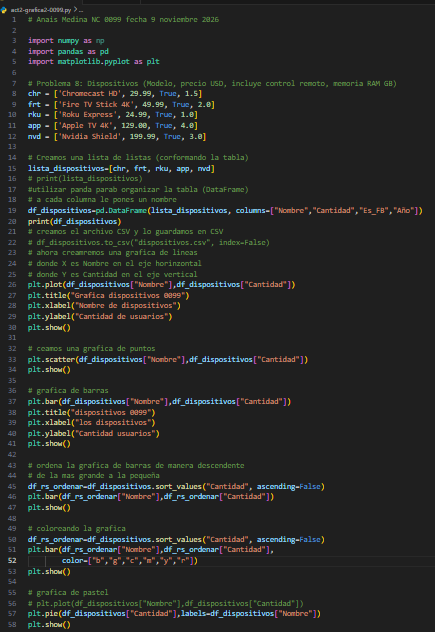
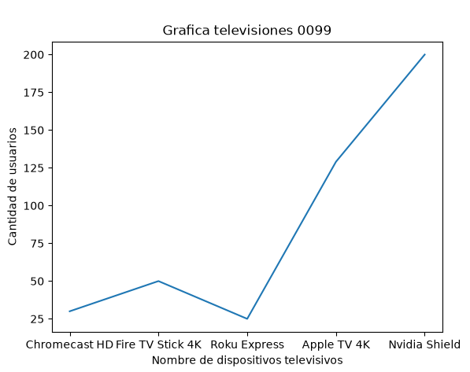
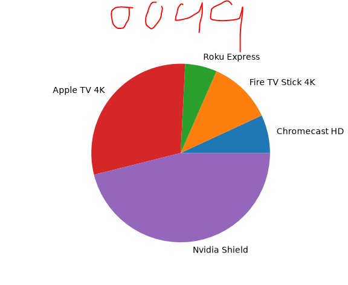

## Dispositivos televisivos mas grandes del mundo 

## codigo 

## grafica lineal 

## grafica de puntos 

## grafica de barras 

## grafica de barras del grande al pequeño

## coloreando la grafica 

## grafica pastel 
